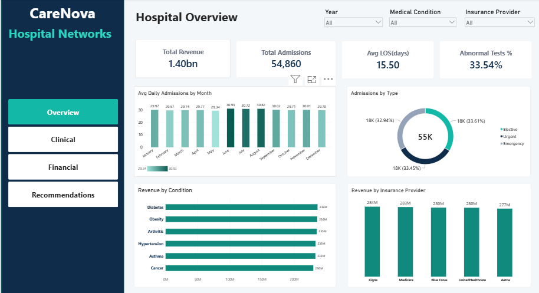
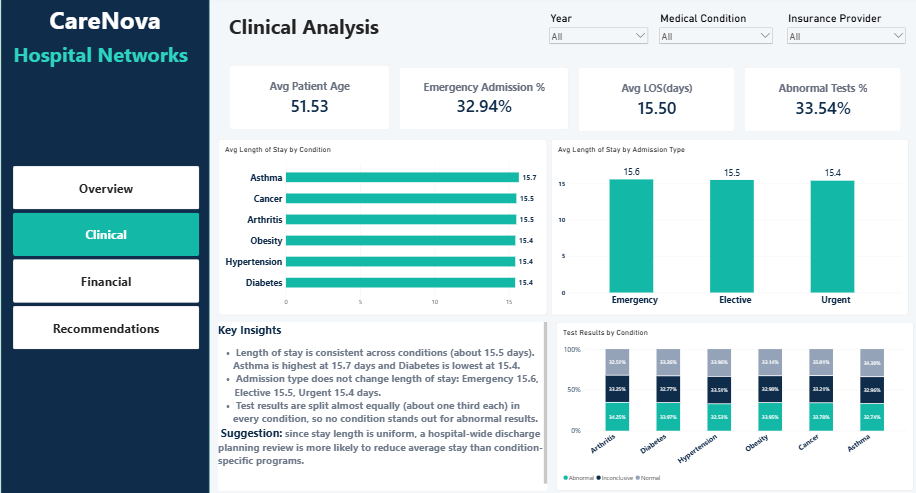
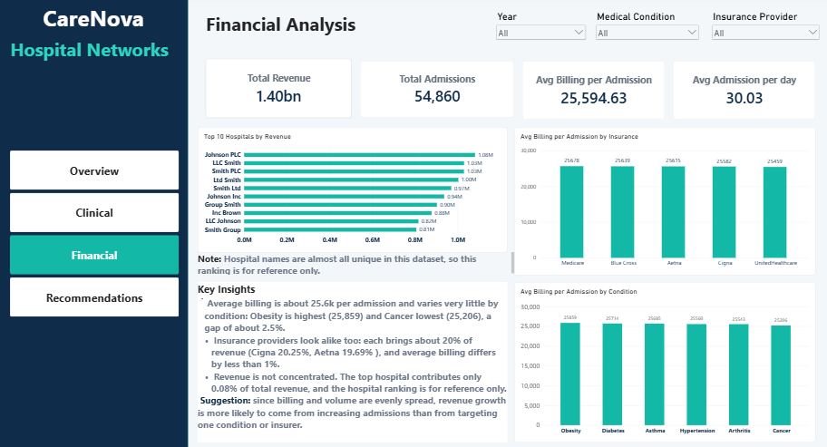
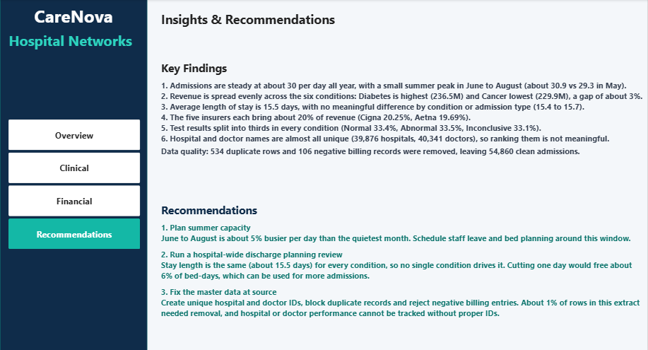

# carenova-hospital-powerbi
Power BI dashboard for a hospital network: Power Query cleaning, star schema, DAX, 4-page report
# CareNova Hospital Performance Dashboard (Power BI)

Practice client project. The client scenario is fictional and the data is the public Kaggle [Healthcare Dataset](https://www.kaggle.com/datasets/prasad22/healthcare-dataset) (synthetic).

## The problem
A hospital network ran its reports manually in Excel and the numbers did not match. The client wanted clean data, a reliable model and answers to 7 business questions on admissions, revenue, length of stay, test results and insurance.

## What I did
- **Power Query:** removed 534 duplicate rows and 106 negative billing records (55,500 to 54,860 rows), standardised patient names (capitalisation, titles and suffixes).
- **Data model:** star schema with 1 fact table and 4 dimension tables (date, condition, insurance, admission type).
- **DAX:** 12 measures (admissions, revenue, average billing, length of stay, test result rates, share of revenue, year-over-year).
- **Dashboard:** 4 pages (Overview, Clinical, Financial, Insights and Recommendations).

## What I found
- Admissions are steady at about 30 per day, with a small summer peak (June to August).
- Revenue, billing and length of stay are almost identical across conditions and insurers.
- Hospital and doctor names are almost all unique, so ranking them is not meaningful.

## Recommendations
1. Plan summer capacity.
2. Run a hospital-wide discharge planning review.
3. Fix master data (unique hospital and doctor IDs).

## Dashboard pages

## Files
The `carenova_hospital_powerbi/` folder has the Power BI file (.pbix), a PDF export of the 4 pages and the dashboard screenshots.

## Tools
Power BI, Power Query, DAX
